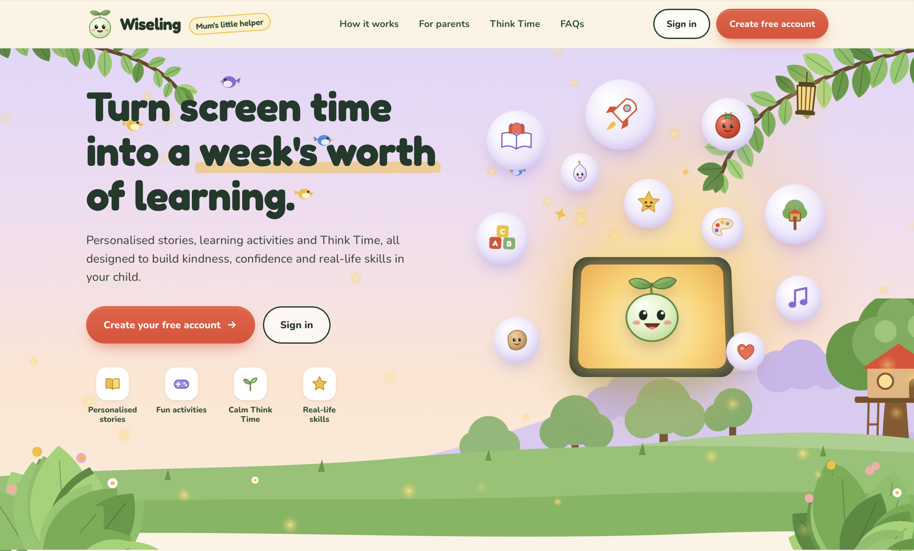
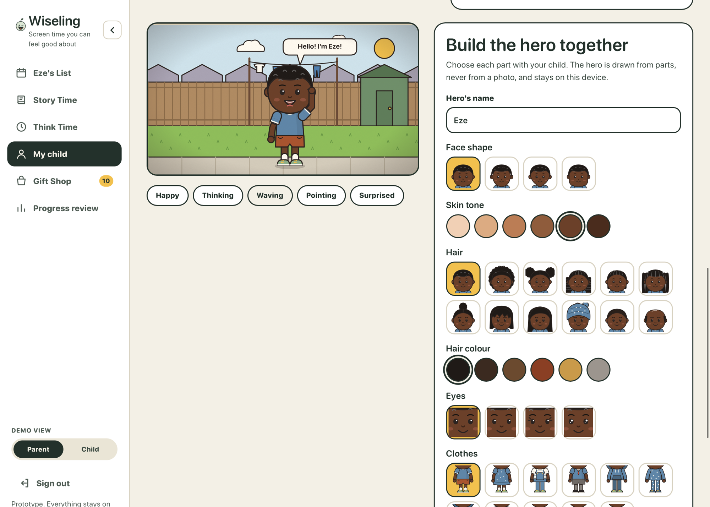
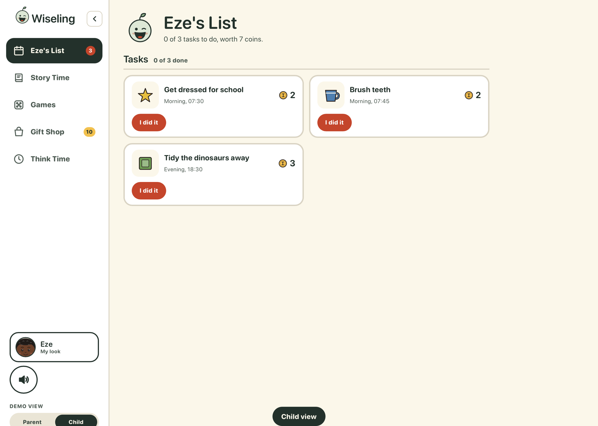
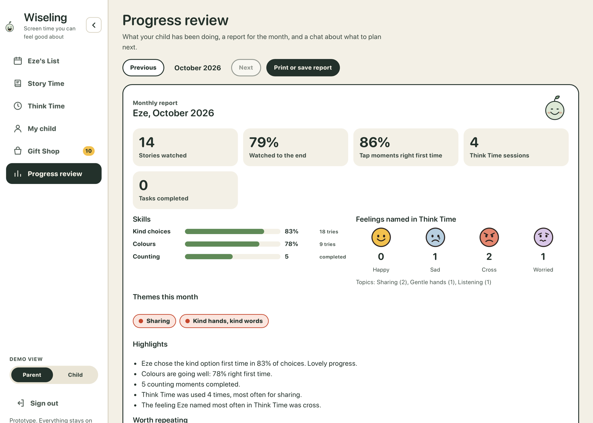

# Wiseling

**Screen time a parent chose.**

Wiseling is a parenting companion for families with children aged 4 to 10. The parent decides what their child should learn this month; Wiseling turns it into a short animated story with the child as the hero.

*This page describes the product. The source code is private.*

---

## The problem

Children's screen time is chosen by algorithms built for engagement: endless feeds, autoplay and streaks. Parents feel guilty about it, but the alternatives are either stock content that knows nothing about their child, or no screen at all.

## How it works

| Step | What happens |
|---|---|
| **Plan** | On a Sunday, the parent spends twenty minutes telling Wiseling what is going on with their child and picks a theme for the month. |
| **Approve** | Wiseling writes a month-long story: four chapters, twelve short episodes. The parent reads it, changes anything, and approves it once. |
| **Watch** | The child gets a three-minute episode on Monday, Wednesday and Friday, starring their own illustrated character. Tuesday and Thursday are game days. Weekends are free. |
| **Practise** | Each episode has a moment that practises the chosen skill, and Think Time helps the child reflect on it. |
| **Review** | The parent sees what was actually watched, answered and earned. |

## Inside Wiseling

**Build the hero together.** Parent and child choose the character's face, hair and clothes. It is drawn from parts, never from a photo.

**The child's list.** Large, simple and illustrated: today's tasks, each worth earned coins.

**The parent's monthly review.** What actually happened: stories watched, skills practised and feelings named in Think Time.

## The one rule

**Everything the child sees was written for them and approved by their parent.** Nothing is chosen from a catalogue, recommended by an algorithm, or generated on demand at the child's request.

## Built so far

- **Parent side and child side**: a calm planning tool on the parent's phone, and a large, illustrated world on the child's iPad
- **Animated story episodes** with fully voiced narration
- **Think Time**, tasks and routines
- **Learning games** for the days between episodes
- **Earned coins** and a Gift Shop, with nothing for sale
- **A parent review** of what happened each month

## Safe by design

- **No open chat between a child and an AI**, in any feature.
- **No photographs of children.** The child's character is generated from parts they pick, never from a photo.
- **No engagement tricks.** No autoplay, no streaks, no daily login rewards, no artificial urgency.
- **Episodes end.** Three minutes, a natural ending, and nothing plays on by itself.
- **No invented scores.** Parents see what happened, never a made-up percentage grading a five-year-old.
- **The child never has an account.** The parent owns it, and the child's device never holds a parent login.

## How it is built

A lightweight web app that installs to an iPad home screen, with large language models writing the stories and generating the illustrations. Built by Emmanuel Machaya with Claude Code, from written product briefs and build specifications.

## Team

Co-founded by **Kadiatou Barry** (CEO) and **Emmanuel Machaya** (CTO).

## Status

Working prototype, built first for the founders' own family.

---

A product of [The Good AI Company](https://thegoodaicompany.com). Contact: [Emmanuel Machaya on LinkedIn](https://www.linkedin.com/in/emmanuelmachaya/)
